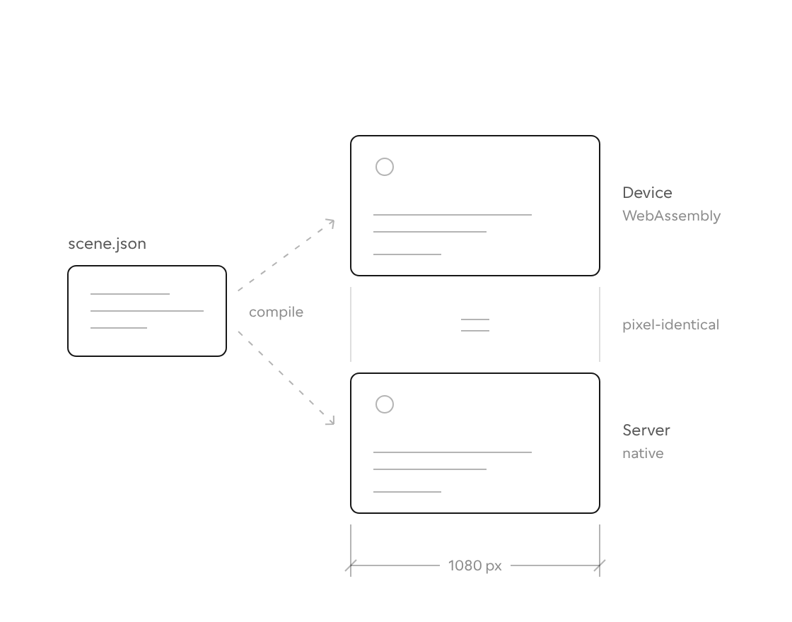
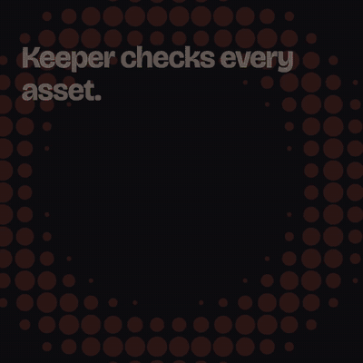
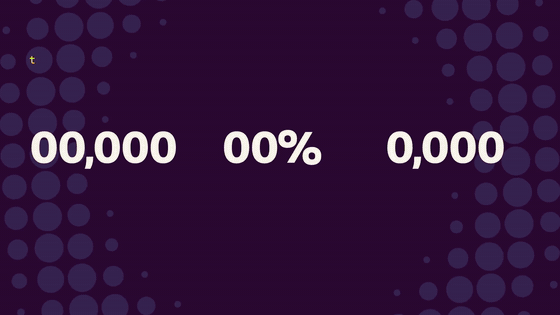
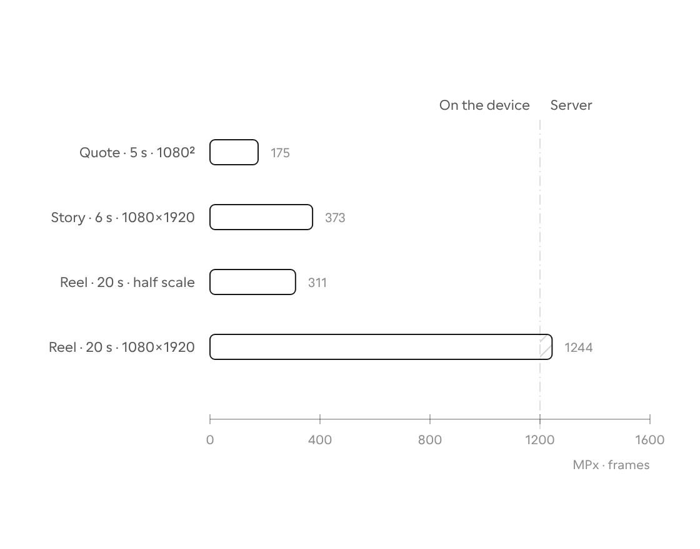
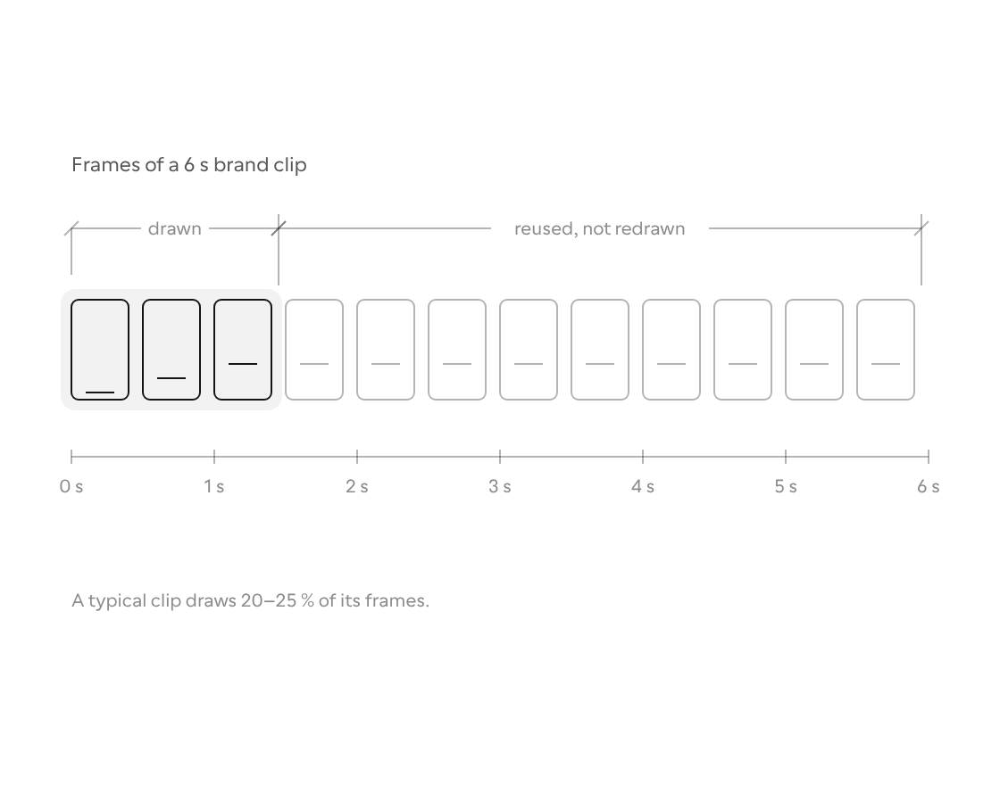
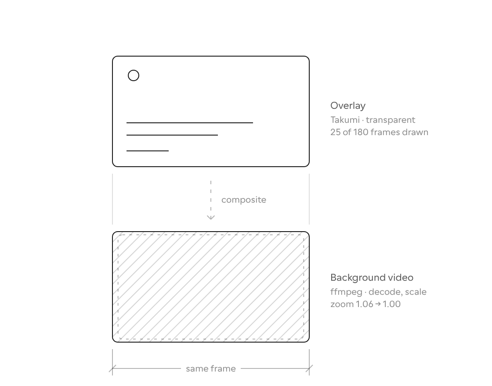

# Optical

`@reallygoodwork/optical`. Named for the optical printer operator, the film-lab craftsperson who layered footage, mattes and titles into one finished negative, frame by frame, the same way every time.

Turn one JSON **scene** into on-brand **PNG, JPEG, WebP, GIF, APNG, animated WebP, MP4, WebM, SVG or PDF**. Your brand's tokens, fonts and motion are applied automatically. It renders on the user's device when it can and on your server when it should, and agents can drive it through plain JSON or MCP.

- **Fast and cheap to run.** Built on [Takumi](https://takumi.kane.tw) (Rust, no headless browser). An OG card takes about 12 ms; a 6-second 1080×1920 motion piece takes about 1.6 s on a 2-core VM. Repeat requests come from cache.
- **One scene, every format and size.** The same scene renders as a still, a GIF, a video or a print-ready PDF, and reflows to any size preset.
- **Composes media.** Background and picture-in-picture video (trim, speed, loop), images, music with fades, real HTML/CSS layers, and Canvas, WebGL or WebGPU drawing.
- **Built for agents.** Brand tokens instead of hex codes, named templates, small edit operations by layer id, a validator that explains mistakes, and contact-sheet previews a model can look at.

<picture>
  <source media="(prefers-color-scheme: dark)" srcset="docs/diagrams/same-frame-dark.png">
  
</picture>

*The same scene produces the same pixels on a device (Takumi in WebAssembly) and on a server (native Takumi). The browser tests check this on every PR.*

**Contents:** [Quick start](#quick-start) · [Examples](#examples) · [Concepts](#concepts) · [Rendering](#rendering) · [Where it runs](#where-it-runs) · [For agents](#for-agents) · [Going further](#going-further) · [Performance](#performance) · [What's supported](#whats-supported) · [Testing and CI](#testing-and-ci) · [Releasing](#releasing) · [Limits](#limits) · [Project layout](#project-layout)

## Quick start

Requirements: Node 20+, and for video on a server, `ffmpeg` on your `PATH` (or set `OPTICAL_FFMPEG`).

Optical lives on GitHub, not npm. Install a release by its tag:

```bash
npm install github:reallygoodwork/optical#v0.1.0
```

Or use the prebuilt tarball attached to each [release](https://github.com/reallygoodwork/optical/releases), which skips the build step:

```bash
npm install https://github.com/reallygoodwork/optical/releases/download/v0.1.0/optical-0.1.0.tgz
```

Either way, you import it as `@reallygoodwork/optical`.

The examples below use the brand in [`examples/brand`](examples/brand). To run them, clone this repo, then `npm install && npm run build`.

Render a template with the example brand:

```ts
import { writeFile } from "node:fs/promises";
import { createNodeStudio, loadBrand } from "@reallygoodwork/optical/node";

const studio = createNodeStudio({ brand: await loadBrand("examples/brand/brand.json") });

const card = await studio.render({ template: "quote-card", props: { quote: "The brand makes the assets now.", author: "Drew" } });
await writeFile(`quote.${card.ext}`, card.data);                       // 1080×1080 PNG

const clip = await studio.render({ template: "quote-card", props: { quote: "Motion, too." } }, { format: "mp4" });
await writeFile(`quote.${clip.ext}`, clip.data);                       // 5 s MP4
```

Or use the CLI:

```bash
node dist/agent/cli.js render quote-card --brand examples/brand/brand.json --props '{"quote":"Hello"}' -f png
node dist/agent/cli.js render examples/scenes/launch-reel.json --brand examples/brand/brand.json -f mp4 -o reel.mp4
node dist/agent/cli.js preview examples/scenes/launch-reel.json --brand examples/brand/brand.json   # contact sheet
```

## Examples

Three sizzle reels for [Demons](examples/demons), a test brand, cut to a 120 BPM beat. Each is one JSON scene with no video footage: type, crew illustrations, brand patterns, HTML/CSS layers animated with `@keyframes`, and a music track. Click a preview for the MP4.

| Summon the crew · reel 1080×1920 · 12 s | Keeper checks · square 1080×1080 · 10 s |
|---|---|
| [](examples/demons/videos/demons-summon-reel.mp4) | [](examples/demons/videos/demons-keeper-square.mp4) |

| Tally's numbers · landscape 1920×1080 · 9 s |
|---|
| [](examples/demons/videos/demons-tally-landscape.mp4) |

| | Summon | Keeper | Tally |
|---|---|---|---|
| Layers | 49 | 13 | 15 |
| Render time, 2-core VM | 9.7 s | 10.5 s | 11.9 s |
| MP4 size | 1.8 MB | 1.5 MB | 1.3 MB |

What each one exercises:
- **Summon:** beat-timed hard cuts, colour wipes, per-word slams, pop-in crew that bob on the beat (generated keyframes), typewriter agent lines, a wobbling sticker, slow-turning pattern grounds.
- **Keeper:** a conveyor of HTML cards driven by CSS `@keyframes` on scene time, a scanner beam, stamped status pills and a colour fix mid-animation.
- **Tally:** odometer counters (digit columns slid with `translateY` inside `overflow: hidden`), a bar chart that grows with `scaleY` from its base, and a halftone end card.

The scenes are in [`examples/demons/scenes`](examples/demons/scenes), generated from [`sizzle.ts`](examples/demons/sizzle.ts). `npm run demons` re-renders the MP4s, posters and contact sheets. `test/demons.test.ts` keeps them honest: the JSON must match the generator, every scene must validate with no warnings, and frames a beat apart must differ.

## Concepts

### Brand

A brand is one JSON file: colours, font roles and files, named text styles, assets, layout and motion defaults. Values can refer to each other with `$` tokens.

```json
{
  "name": "Lumen",
  "colors": { "ink": "#14121F", "paper": "#F6F1E9", "primary": "#2A1B5C", "accent": "#FF6B4A" },
  "fonts": { "display": "Inter Display", "body": "Inter" },
  "fontFaces": [{ "family": "Inter", "src": "./fonts/Inter-Regular.otf", "weight": 400 }],
  "text": { "display": { "font": "Inter Display", "weight": 700, "lineHeight": 1.02 } },
  "assets": { "logo": "./logo.svg", "logoOnDark": "./logo-on-dark.svg" },
  "layout": { "margin": 72 },
  "motion": { "duration": 0.6, "ease": "outCubic" },
  "defaults": { "background": "$colors.paper", "color": "$colors.ink", "font": "Inter" }
}
```

`loadBrand(path)` resolves relative font and asset paths against the file's folder. The full example is in [`examples/brand`](examples/brand).

### Scene

A scene is a size, an optional duration, and a stack of layers drawn bottom to top. Any string starting with `$` is a brand token (`$colors.accent`, `$assets.logo`), and tokens also work inside strings (`"linear-gradient(90deg, $colors.ink, $colors.accent)"`).

```ts
{
  size: "reel",                // a preset, "1200x800", or { width, height }
  duration: 8,                 // seconds; omit for a still
  layers: [
    { id: "bg", type: "video", src: "broll.mp4", trim: [2, 10], volume: 0.3 },
    { id: "scrim", type: "shape", fill: "linear-gradient(180deg, transparent 40%, $colors.ink)" },
    { id: "headline", type: "text", text: "Fall drop is live", textStyle: "display", size: 140,
      width: "86%", height: 420, position: "bottom-left", enter: "rise", exit: "fade" },
    { id: "logo", type: "image", src: "$assets.logoOnDark", width: 220, height: 80,
      position: "top-left", enter: { preset: "fade", delay: 0.4 } },
  ],
  audio: [{ src: "track.mp3", volume: 0.8, fadeOut: 1 }],
}
```

| Layer | What it draws |
|---|---|
| `text` | Copy in a brand text style. With a `height` it shrinks to fit its box (`fit: "box"`); `fit: "line"` keeps it on one line. |
| `image` | An image, SVG or asset token, with `fit` and `focus`. |
| `video` | A clip with `trim`, `speed`, `loop` and `volume`. Its audio is mixed in automatically. |
| `shape` | A rectangle or circle, with a fill (including gradients) and an optional stroke. Useful for scrims and blocks. |
| `group` | Children laid out in a `row`, `column` or `stack`. |
| `node` | Real HTML and CSS ([see below](#html-and-css-layers)). |
| `source` | Pixels from your own code: Canvas, WebGL, WebGPU ([see below](#frame-sources-canvas-webgl-webgpu)). |

Every layer has the same placement, timing and motion fields:

- **Placement:** no geometry fills the frame (good for backgrounds). `position` (`"center"`, `"bottom-left"`…) plus a `width`/`height` snaps inside the safe margin and reflows across sizes. `x`/`y` place absolutely, in px or `%`.
- **Timing:** `start` and `end` in seconds.
- **Motion:** `enter` and `exit` presets (`fade`, `rise`, `drop`, `slide-left`, `slide-right`, `zoom`, `pop`, `blur`, `wipe`, `typewriter`), or `keyframes` for anything else (`x`, `y`, `scale`, `rotate`, `opacity`, `blur`). A still always shows the settled pose.

Size presets include `square`, `instagram-post`, `instagram-story`, `reel`, `tiktok`, `youtube`, `youtube-thumbnail`, `og`, `twitter-post`, `linkedin-post`, `linkedin-banner`, `slide`, `a4`, `letter` and display-ad sizes. The full list is `SIZES` in [`src/core/sizes.ts`](src/core/sizes.ts).

### Templates

A template is a function from props to a scene. Four ship with the library: `quote-card`, `announcement`, `stat` (a number that counts up) and `title-card`. Add your own with `defineTemplate` and a zod schema for the props. Agents see that schema through `list_templates`.

```ts
studio.render({ template: "announcement", props: { headline: "Launch day", media: "broll.mp4" } }, { format: "mp4" });
```

### Edits

Change a scene with small operations that target layers by `id`. They return a new scene and never modify the old one, so an edit history is just an array.

```ts
import { edit } from "@reallygoodwork/optical";

const next = edit(scene, [
  { op: "set", target: "headline", path: "text", value: "Fall drop: 20% off" },
  { op: "merge", target: "logo", value: { enter: "pop" } },
  { op: "retime", target: "logo", start: 1 },
  { op: "set", target: "scene", path: "size", value: "square" },
]);
```

The full set is `set`, `merge`, `add`, `remove`, `move`, `retime`, `replace` and `duplicate`.

## Rendering

`studio.render(input, options)` takes a scene, or `{ template, props }`, and returns:

```ts
{ data, mime, ext, width, height, duration, frames, key, ms, cached, engine, scene }
```

`scene` is the expanded scene with ids assigned (feed it back into `edit`). `key` is a stable hash of everything that affects the output, so you can use it as a cache or CDN key.

| Option | Meaning |
|---|---|
| `format` | `png` (default), `jpeg`, `webp`, `gif`, `apng`, `webp-animated`, `mp4`, `webm`, `svg`, `pdf` |
| `size` | Overrides the scene's size, e.g. `"og"` |
| `at` | For a still from a timed scene: the moment to capture. Defaults to when every entrance has settled. |
| `scale` | Resolution multiplier with identical layout. `0.5` makes fast drafts. |
| `quality` | 0–100 for lossy formats |
| `fps` | Frame rate for video and animation (default 30; GIFs default to 15) |
| `frames` | `[from, to)`: render one chunk of a long video (see [parallel rendering](#long-videos-in-parallel)) |
| `fresh` | Skip the cache |

Other calls on the studio:

| Call | Returns |
|---|---|
| `studio.variants(input, ["instagram-story", "square", "og"])` | The same scene in many sizes. Layouts built with `position` and `%` reflow. |
| `studio.preview(input)` | One PNG contact sheet of the timeline, with timestamps. Cheap enough to call after every edit. |
| `studio.validate(input)` | Schema errors, unknown tokens, impossible timings, unreachable media and low text contrast, with paths. No render. |
| `studio.document([pageA, pageB])` | A multi-page PDF (decks, one-pagers, certificates); pages can differ in size. |
| `studio.typst(source, inputs)` | Long-form PDFs with Typst (server only). Brand colours and fonts arrive as `sys.inputs.brand`. |
| `studio.listTemplates()` | Template names, descriptions and prop schemas |

## Where it runs

### On a server or in an agent: `@reallygoodwork/optical/node`

Uses native Takumi plus ffmpeg. This is the right choice for agents, scheduled jobs, APIs and anything without a browser.

```ts
import { createNodeStudio, loadBrand } from "@reallygoodwork/optical/node";
const studio = createNodeStudio({
  brand: await loadBrand("brand.json"),
  store: myCache,               // optional { get, set }: Blob, R2, KV, disk. Identical requests never render twice.
});
```

### On the user's device: `@reallygoodwork/optical/browser`

Uses Takumi compiled to WebAssembly, and WebCodecs (through [Mediabunny](https://mediabunny.dev)) to decode source media and encode MP4/WebM. Rendering on the device costs you nothing. When a job is too big for the device, it goes to your server.

```ts
import { createBrowserStudio } from "@reallygoodwork/optical/browser";

const studio = createBrowserStudio({
  brand,
  remote: { url: "/api/render" },   // optional server fallback
  policy: { deviceBudget: 1200 },   // megapixel-frames the device takes on
});
await studio.warm();                // load wasm and fonts up front
const r = await studio.render(scene, { format: "mp4" });
r.engine;                           // "browser" or "remote"
await studio.route(scene, { format: "mp4" });   // { engine, reason }, for your UI
```

<picture>
  <source media="(prefers-color-scheme: dark)" srcset="docs/diagrams/device-budget-dark.png">
  
</picture>

*A job's work is width × height × frames. The default budget of 1200 is about 20 seconds of 1080×1920 video. Rendering a draft at `scale: 0.5` brings a long reel back onto the device.*

Routing rules, in order:

1. A scene that uses `blob:` media renders on the device, because only the device can read it.
2. If the browser can't encode the format, the job goes to the server.
3. If the job is bigger than `deviceBudget`, it goes to the server.
4. If rendering fails on the device, it's retried on the server.

The whole studio also runs inside a Web Worker, which keeps the page responsive. Your bundler resolves the wasm through `@takumi-rs/wasm/auto`; if it can't, pass URLs: `backend: { wasm: "/takumi_wasm_bg.wasm", pdfWasm: "/takumi_pdf_wasm_bg.wasm" }` (both files ship in `node_modules`).

### As an HTTP endpoint: `@reallygoodwork/optical/server`

One Request/Response handler covers everything a client or agent needs. It works in a Next.js route, a Vercel Function, Hono or Bun.

```ts
// app/api/render/route.ts
import { createNodeStudio, loadBrand } from "@reallygoodwork/optical/node";
import { createRenderHandler } from "@reallygoodwork/optical/server";
import { put } from "@vercel/blob";

const studio = createNodeStudio({ brand: await loadBrand(process.cwd() + "/brand/brand.json") });
export const maxDuration = 300;
export const POST = createRenderHandler(studio, {
  // Vercel caps response bodies at 4.5 MB: larger files go to Blob and the handler returns a URL
  upload: async (r) => (await put(`renders/${r.key}.${r.ext}`, Buffer.from(r.data), { access: "public", addRandomSuffix: false, allowOverwrite: true })).url,
});
```

The request body is `{ action, … }`, where `action` is `render`, `preview`, `variants`, `document`, `typst`, `edit`, `validate` or `templates`. `node dist/agent/cli.js serve --brand brand.json` starts the same handler locally.

### Long videos in parallel

Split a video into frame ranges, render them on separate workers, and join the results. Audio is laid under the joined video.

```ts
const { ranges } = await studio.plan(input, 6);
const chunks = await Promise.all(ranges.map((frames) => studio.render(input, { format: "mp4", frames }).then((r) => r.data)));
const mp4 = await studio.join(input, chunks);
```

[`examples/nextjs`](examples/nextjs) sketches the same flow with a queue (not exercised by the tests; the plan/render/join path is).

## For agents

```bash
node dist/agent/cli.js mcp --brand ./brand.json --out ./optical-out
```

This starts an MCP server with these tools:

| Tool | Does |
|---|---|
| `get_brand` | Tokens, text styles, assets, sizes, registered sources and the scene-writing guide. Call it first. |
| `list_templates` | Templates and their prop schemas |
| `render` | Any formats × any sizes in one call. Returns files, a `sceneId`, and an image the model can see: the still itself, or a contact sheet for motion. |
| `preview` | A contact sheet, for checking motion and layout cheaply |
| `edit_scene` | Edit operations on a stored scene by `sceneId`, then a preview or render |
| `validate` | Problems with paths, before spending a render |
| `get_scene` | The full JSON of a stored scene |
| `make_document` | A multi-page PDF from pages or Typst |

Scenes are stored on the server and addressed by `sceneId`, so an agent iterates with small edits instead of resending JSON. [`examples/mcp.json`](examples/mcp.json) has a client config. [AGENTS.md](AGENTS.md) is the guide an agent reads.

Without MCP, the same tools work with any SDK:

```ts
import { createAgentTools } from "@reallygoodwork/optical/agent";
const tools = createAgentTools(studio, { outDir: "./out" });
tools.anthropic();   // tool definitions for the Anthropic Messages API
tools.openai();      // function-calling definitions
await tools.call("render", { template: "quote-card", props: { quote: "…" }, sizes: ["square", "og"] });
```

## Going further

### HTML and CSS layers

A `node` layer takes real HTML and CSS with browser semantics. Brand tokens work inside the CSS, and `@keyframes` animate with the scene's clock in video.

```ts
{
  type: "node",
  html: `<div class="card"><div class="badge"></div><h1>Launch</h1></div>`,
  css: `.card { display: grid; grid-template-columns: auto 1fr; background: color-mix(in oklch, $colors.accent 15%, white) }
        .card:has(.badge) h1 { color: $colors.primary }
        .badge { animation: pulse 1s infinite }`,
}
```

Put scene-wide CSS in `scene.css`. What's supported is listed in [What's supported](#whats-supported).

### Frame sources: Canvas, WebGL, WebGPU

When something can't be expressed as layers, register code that draws it. A source runs once per frame, in order, so stateful animation works.

```ts
studio.registerSource("shader", {
  setup: ({ width, height }) => { /* compile a WebGL program, allocate an OffscreenCanvas */ },
  draw: ({ t, width, height, props }) => canvas,   // or an ImageBitmap, ImageData, or { width, height, data }
});
// in a scene: { type: "source", source: "shader", props: { speed: 2 } }
```

Sources work with Canvas 2D, OffscreenCanvas, WebGL/WebGL2, WebGPU (read back through a buffer), Three.js and lottie-web in the browser, and with `@napi-rs/canvas` on Node.

## Performance

Measured on a 2-vCPU Xeon @ 2.3 GHz (a small cloud VM) with Node 22. CPU includes ffmpeg; each figure is the median of 5 runs (`npm run perf`).

| Output | Wall | CPU | Size |
|---|---:|---:|---:|
| OG card PNG 1200×630 | 12 ms | ~0 | 10 KB |
| Quote JPEG 1080² | 33 ms | 35 ms | 39 KB |
| Three sizes, PNG | 28 ms | 30 ms | 18 KB |
| Stat GIF, 2 s at 720² | 144 ms | 249 ms | 96 KB |
| Quote MP4, 5 s at 1080² | 840 ms | 1.3 s | 27 KB |
| Story MP4, 6 s at 1080×1920, text motion | 1.6 s | 2.9 s | 58 KB |
| Story MP4, 6 s at 1080×1920, video background + Ken Burns | 4.9 s | 8.1 s | 1.0 MB |
| HTML/CSS layer MP4, 3 s | 532 ms | 930 ms | 43 KB |
| Contact sheet of a video scene | 432 ms | 666 ms | 353 KB |
| Cache hit | < 1 ms | — | — |

What keeps it cheap on a server:

**Frame reuse.** Each compiled frame is fingerprinted, and a frame identical to the one before it isn't drawn again. Brand motion usually settles within a second, so a typical clip draws only 20–25% of its frames. Animated GIF and WebP merge identical runs into a single longer frame.

<picture>
  <source media="(prefers-color-scheme: dark)" srcset="docs/diagrams/frame-reuse-dark.png">
  
</picture>

**Background video composited by the encoder.** When the bottom layer is a full-frame video (optionally with a linear Ken Burns zoom), ffmpeg decodes, scales and zooms it itself. Takumi only draws everything above it as a transparent overlay, which is mostly static, so frame reuse applies there too. Node CPU for that render drops about 88%. A test keeps the result visually equivalent to the reference path (SSIM ≥ 0.99). Anything the encoder can't reproduce exactly falls back automatically: rounded corners, opacity, entrance/exit animations, eased keyframes, `fit: "contain"`. Turn it off with `studio.fastPaths = false`.

<picture>
  <source media="(prefers-color-scheme: dark)" srcset="docs/diagrams/base-video-dark.png">
  
</picture>

**Also:**
- Contact sheets pull all their video frames from one decode pass instead of one seek per thumbnail. That's 4× faster, with identical pixels.
- Video is never decoded larger than its source.
- Encoder settings were chosen by measurement. x264 `veryfast` at CRF 20 is the sweet spot:
  - `superfast` saves no CPU and makes files 1.5–2.5× larger.
  - `ultrafast` saves about 35% CPU but makes files 3–4× larger, and the extra bandwidth costs more than the CPU it saves.
  - `faster` costs about 70% more CPU for the same size.

## What's supported

**CSS: 85 of 91 cases match Chrome 153** (pixel diff, anti-aliasing ignored). `npm run test:conformance` writes the full table with side-by-side images.

| Area | Status |
|---|---|
| Layout: flex, grid (areas, spans, auto-fill/minmax), block flow, margin collapse, inline-block, float, absolute/inset/z-index, calc/min/max/clamp, aspect-ratio, logical properties, overflow | ✅ all |
| Box: radius (elliptical), border styles, per-side colours, box-shadow (inset, spread, multiple), outline | ✅ all |
| Backgrounds: linear, radial, conic and repeating gradients, layered backgrounds, size/position/repeat, `background-clip: text` | ✅ all |
| Colour: hsl/hwb/hex8, oklch/oklab/lab/lch, `color-mix()`, relative colour, custom properties, currentColor | ✅ all |
| Transforms: 2D, skew, origin, matrix, individual rotate/scale/translate | ✅ · ❌ 3D `perspective` |
| Effects: opacity, all filters, drop-shadow, backdrop-filter, blend modes, clip-path, mask-image | ✅ all |
| Type: weights and italics, wrapping and justify, spacing, transform, decoration (incl. wavy), shadow, stroke, line-clamp, ellipsis, pre, overflow-wrap, `text-wrap: balance`, CJK, emoji, tabular numbers | ✅ · 🟡 list markers · ❌ `writing-mode` |
| Selectors: descendant/child/sibling, `:nth-child`, `:not()`, `:has()`, `::before`/`::after`, nesting, `@media`, `@layer`, `@supports` | ✅ · ❌ `@container`, `!important` |
| Animation: `@keyframes`, cubic-bezier, delay and fill-mode | ✅ · ❌ a 0→360° rotation doesn't move (Takumi interpolates it as a matrix) |

Takumi treats every element as `border-box`. HTML layers switch back to the browser's `content-box` automatically (`BROWSER_COMPAT_CSS`); scene layers stay `border-box`, which is what designers expect.

**Browser APIs: 20 of 20 checks pass in Chrome:**
- WebAssembly
- WebCodecs encoding (H.264, VP9, AV1) and decoding
- OffscreenCanvas 2D, WebGL, WebGL2 and WebGPU sources
- Audio mixing with OfflineAudioContext
- Web Workers
- WASM output identical to native

## Testing and CI

```bash
npm test                  # unit and Node render tests (needs ffmpeg)
npm run test:browser      # real Chrome: WASM, WebCodecs, Canvas/WebGL/WebGPU, workers, WASM-native parity
npm run test:conformance  # 91 CSS cases against Chrome; fails only on regressions from the baseline
npm run test:all          # all of the above plus typecheck
npm run perf              # the performance table above
```

[`.github/workflows/ci.yml`](.github/workflows/ci.yml) runs all of it on every pull request.
- **Cost:** it uses standard `ubuntu-latest` runners and first-party actions only. That's free on public repos and about 4–5 included minutes per PR on private ones.
- **Keeping it cheap:** it uses the runner's preinstalled Chrome, cancels runs a newer push replaces, skips docs-only changes, and keeps artifacts for 7 days.
- **Results:** each PR gets one comment with the CSS matrix and browser checks, updated on every push.
- **After a Takumi upgrade:** run **Update conformance baseline** from the Actions tab to accept new results.
- **When the runner's Chrome updates:** the baseline records which Chrome major it was captured with. Against a different major, changed cases show as a warning instead of failing the build, since the reference moved, not Optical. Run **Update conformance baseline** to re-baseline on the new Chrome.
- **Updates:** Dependabot groups Takumi releases into one PR so the comment shows exactly what changed.

## Releasing

GitHub is the source of truth. There's no npm package. Every push to `main` runs CI, then [semantic-release](https://semantic-release.gitbook.io) reads the commit messages since the last tag, picks the next [semantic version](https://semver.org), tags the commit and writes a GitHub release with notes and a prebuilt tarball.

The commit type decides the version:

| Commit | Release | Example |
|---|---|---|
| `feat:` | minor | `feat(browser): render WebM on device` |
| `fix:` `perf:` `refactor:` `deps:` | patch | `fix(node): centre the crop when zooming` |
| `feat!:` or a `BREAKING CHANGE:` footer | major | `feat!: rename Scene.layers to Scene.items` |
| `docs:` `test:` `ci:` `chore:` | none | `docs: add the Demons reels` |

- **Pull requests:** squash-merge them. The PR title becomes the commit message, and the **PR title** check keeps it in this form.
- **Prereleases:** push to `next` or `beta` to release `1.2.0-next.1` style versions, marked as prereleases on GitHub.
- **Dependabot:** runtime dependency bumps are `deps:` (patch release); dev and Actions bumps are `chore:` and `ci:` (no release).
- **No secrets:** the workflow only uses the repo's built-in `GITHUB_TOKEN`.
- **First run:** semantic-release would start at 1.0.0, so when there's no version tag yet the workflow cuts `v0.1.0` itself and semantic-release takes over from the next push.
- **Installing from a tag:** `npm install github:reallygoodwork/optical#vX.Y.Z` builds the package on install (the `prepare` script). The release tarball is already built.

## Limits

- **Takumi isn't a browser.** See [What's supported](#whats-supported). WebGL, WebGPU, Canvas and Lottie come in through `source` layers.
- **Video layers are the expensive part.** Use `scale: 0.5` for drafts and `preview()` while iterating.
- **Server codecs depend on your ffmpeg build.** H.264 needs libx264; WebM needs libvpx-vp9 and libopus.
- **Browser codecs depend on the browser.** `route()` checks before committing to a device render.
- **Fonts:** Takumi has no system fonts. Every font the brand uses must be listed in `fontFaces`.

## Project layout

```
src/core        platform-neutral: schema, tokens, motion, compile, edit, validate, templates, studio
src/node        native Takumi + ffmpeg backend; NodeStudio (plan/join), loadBrand
src/browser     Takumi WASM + Mediabunny/WebCodecs backend; routing BrowserStudio
src/server      createRenderHandler (Request → Response)
src/agent       tool definitions, MCP server, CLI
test/           unit + render tests, browser capability tests, CSS conformance suite
site/           landing page (static; deploy as-is, see vercel.json)
examples/       brands (Lumen, Demons), scenes, sizzle reels, media, Next.js routes, React hook, MCP config
docs/diagrams/  the drawings in this README (source + renders)
```

### Credits

- Rendering: [Takumi](https://github.com/kane50613/takumi)
- Browser media: [Mediabunny](https://mediabunny.dev)
- Documents: [Typst](https://typst.app)
- Diagrams: drawn with [Plotter](https://plotter.pasqualevitiello.com) (MIT). Regenerate them with `docs/diagrams/build.sh`.
